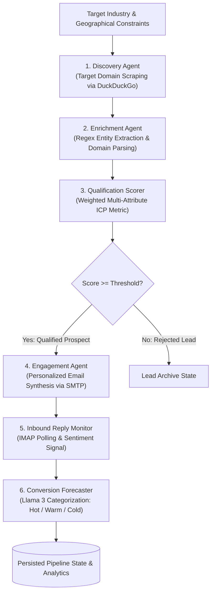

# Autonomous Multi-Agent B2B Discovery and Engagement Pipeline

[](https://vitejs.dev/)
[](https://fastapi.tiangolo.com/)
[-orange)](https://groq.com/)
[](https://huggingface.co/spaces)
[](LICENSE)

---

## Architectural Overview

B2B prospecting pipelines require coordinating web extraction, heuristic data validation, entity enrichment, and personalized communication while ensuring strict compliance with outreach thresholds. Disjointed scripts often produce corrupted state, duplicate messaging, or poor qualification accuracy.

This project implements an **Agent-of-Agents Pipeline** composed of six specialized functional agents coordinated through a deterministic execution graph. The architecture partitions lead discovery into discrete phases: search retrieval, HTML scraping and contact extraction, multi-attribute Ideal Customer Profile (ICP) scoring, context-aware email generation, inbound response monitoring, and conversion probability forecasting.

---

## Computational Graph & Agent Roles



### Agent Responsibilities

| Agent Node | Execution Mechanism | Functional Responsibility |
| :--- | :--- | :--- |
| **Discovery Agent** | Search API / Web Crawling | Scrapes domain listings matching targeted market criteria. |
| **Enrichment Agent** | HTML Parser / Regular Expressions | Extracts business contact emails, corporate registries, and executive metadata. |
| **Qualification Scorer** | Weighted Linear Scoring | Evaluates lead fit based on domain legitimacy, role relevance, and data completeness. |
| **Engagement Agent** | Llama 3 Inference + SMTP | Synthesizes tailored communication aligned with business context and dispatches emails. |
| **Inbound Monitor** | IMAP Polling + Token Matching | Listens for inbound replies and extracts intent signals (interested, unsubscribe, referral). |
| **Conversion Forecaster** | Prompt-Engineered Classifier | Evaluates communication history to assign conversion probabilities (Hot, Warm, Cold). |

---

## Qualification Formulation

Let candidate prospect $L_j$ have extracted feature vector $\mathbf{x}_j = [x_{j,1}, x_{j,2}, \dots, x_{j,d}]^T \in [0, 1]^d$, representing data completeness, domain authority, verified email validity, and industry keyword alignment.

The composite qualification score is computed as:

$$S(L_j) = \sum_{k=1}^d w_k x_{j,k} \quad \text{subject to} \quad \sum_{k=1}^d w_k = 1, \ w_k \ge 0$$

Prospects advance to personalized outreach dispatch if and only if:

$$S(L_j) \ge \tau_{\text{qual}}$$

where $\tau_{\text{qual}}$ is the configurable qualification threshold, ensuring unverified or low-relevance leads do not trigger unsolicited email dispatch.

---

## System Implementation

* **Frontend:** React 19, Vite, Tailwind CSS, Framer Motion, Recharts analytics dashboard.
* **Backend:** FastAPI, Python 3.11, Docker containerized execution.
* **LLM Orchestration:** High-speed Llama 3 inference hosted on Groq Cloud to deliver sub-second generation.
* **Persistence:** Stateful pipeline logging using tabular storage and session state management.

---

## Installation & Deployment

### Local Development

1. **Clone the Repository:**
   ```bash
   git clone https://github.com/ahmadarif238/AI-Sales-Automation-Agent.git
   cd AI-Sales-Automation-Agent
   ```

2. **Backend Execution:**
   ```bash
   cd backend
   pip install -r requirements.txt
   python app.py
   ```
   Backend initializes on `http://localhost:7860`.

3. **Frontend Execution:**
   ```bash
   cd ../frontend
   npm install
   npm run dev
   ```
   Client initializes on `http://localhost:5173`.

### Production Deployment

* **Backend (Hugging Face Spaces):** Deploy as a Docker Space with repository secrets `GROQ_API_KEY`, `EMAIL_ADDRESS`, and `EMAIL_PASSWORD`.
* **Frontend (Vercel):** Connect repository root directory `frontend/` and configure `VITE_API_URL` to point to the backend Space URL.

---

## Author & Academic Context

Engineered by **Arif Ahmad Khan** as an implementation of deterministic multi-agent state machines and automated outbound pipeline governance.

Released under the [MIT License](LICENSE).
